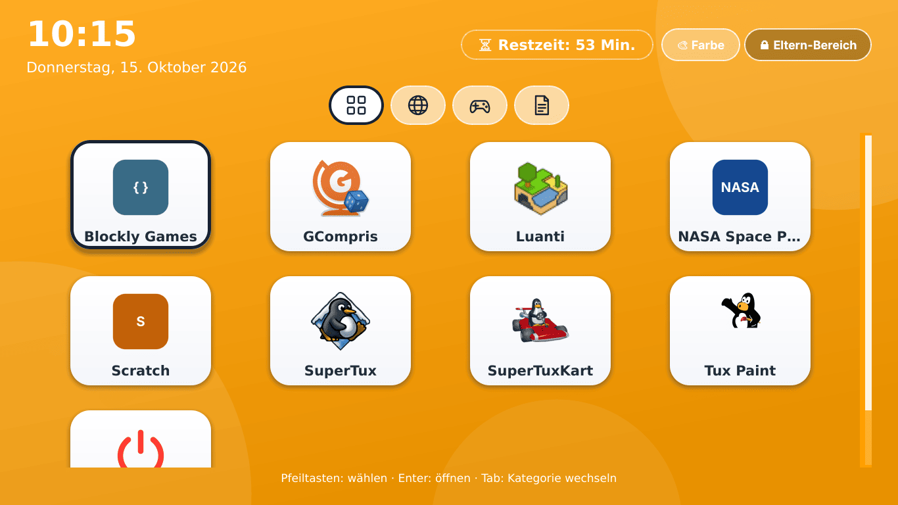
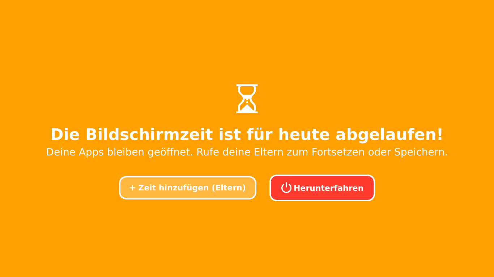
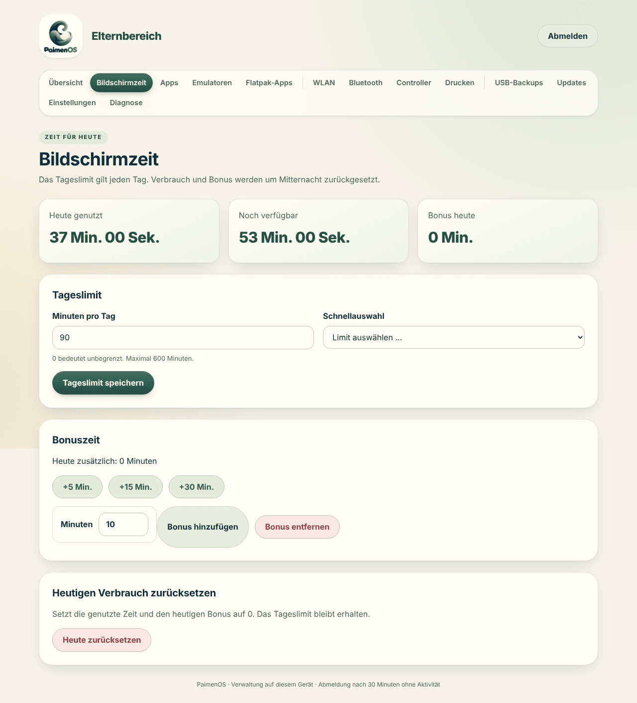
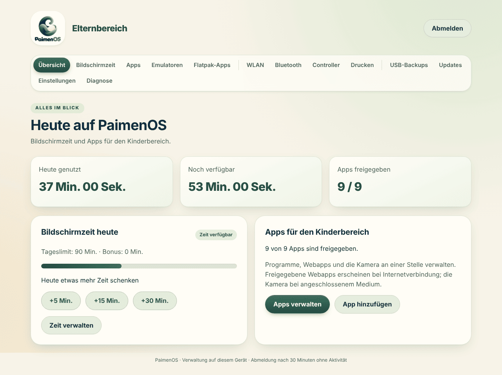
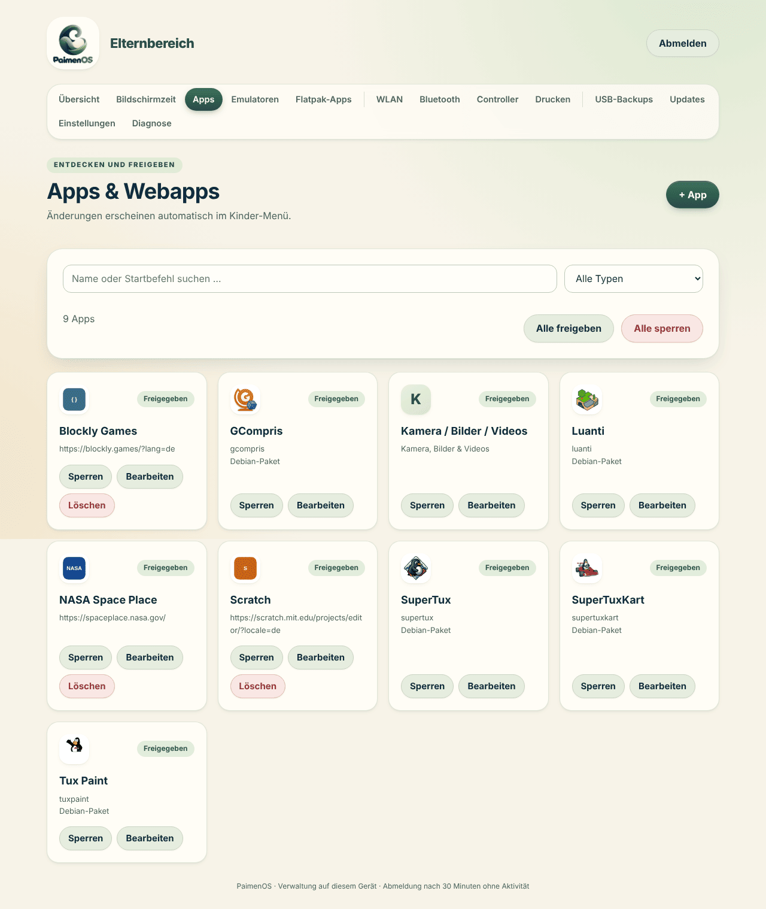
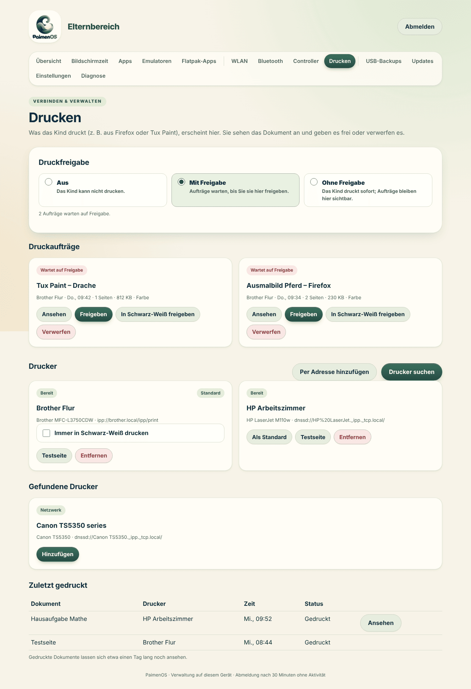

<p align="center">
  
</p>

<h1 align="center">PaimenOS</h1>

<p align="center">
  <b>Ein abgeschlossenes Kinder-Betriebssystem auf Debian-Basis</b><br>
  Kachelmenü für Kinder · Bildschirmzeit mit Sperrbildschirm · Eltern-Bereich im Browser · Drucken mit Freigabe · Emulatoren · eigenes Installations-ISO
</p>

<p align="center">
  <a href="README.md">English</a> ·
  <a href="#installation">Installation</a> ·
  <a href="#fehlersuche">Fehlersuche</a> ·
  <a href="docs/">Dokumentation</a>
</p>



PaimenOS macht aus einem Laptop einen Kinder-Computer, der sich wie ein eigenes Gerät anfühlt und nicht wie ein Desktop mit Kindersicherung. Nach dem Einschalten erscheint direkt das Kachelmenü; es gibt keinen Desktop, keine Dateiverwaltung und keine Systemeinstellungen, an die das Kind kommt. Was erlaubt ist, wie lange gespielt werden darf und was gedruckt wird, entscheiden die Eltern im Eltern-Bereich, am Gerät oder vom Handy aus.

*Paimen* ist Finnisch für Schäfer. Aktuelle Version: siehe [`VERSION`](VERSION) und die [Release-Notizen](docs/releases/).

## Inhalt

- [Funktionen](#funktionen)
- [Installation](#installation)
- [Updates und Rollback](#updates-und-rollback)
- [Fehlersuche](#fehlersuche)
- [Entwickeln](#entwickeln)
- [Projektaufbau](#projektaufbau)
- [Weitere Dokumentation](#weitere-dokumentation)

---

## Funktionen

### Kinder-Menü

Das Menü ist die einzige Oberfläche, die das Kind sieht. Es startet automatisch nach dem Hochfahren (LightDM-Autologin für den Benutzer `kids`, Openbox ohne Desktop) und kommt nach dem Schließen jeder App wieder nach vorn.

- **Große Kacheln** für Programme, Webapps, Spiele, Emulator-Spiele, die Kamera und das Ausschalten.
- **Kategorien** als Symbolreiter (Alles, Webapps, Spiele, Produktiv); leere Kategorien werden ausgeblendet.
- **Bedienung mit Maus, Tastatur, Touchpad oder Gamepad.** Pfeiltasten bzw. Steuerkreuz wählen, Enter bzw. die Bestätigungstaste öffnet, Tab bzw. die Schultertasten wechseln die Kategorie. Win+M holt das Menü jederzeit zurück.
- **Kopfzeile** mit Uhr, Datum, Akkustand, verbleibender Bildschirmzeit und der Zahl wartender Druckaufträge.
- **Eigene Farbe:** Das Kind wählt die Hintergrundfarbe über **Farbe** selbst.
- **Vorlesen:** Auf Wunsch liest das Menü den Namen der gewählten Kachel vor (Piper, Männer- oder Frauenstimme, läuft offline).
- **Webapps nur mit Internet:** Ohne Verbindung werden Webapp-Kacheln ausgeblendet statt mit Fehlerseiten zu öffnen.
- **Lautstärke und Helligkeit** über F1–F3 und F5/F6 oder die Hardwaretasten, mit eigener Bildschirmanzeige.

### Bildschirmzeit und Sperrbildschirm

 

- **Tageslimit** in Minuten (0 = unbegrenzt), täglich um Mitternacht zurückgesetzt.
- **Bonuszeit** per Knopfdruck (+5, +15, +30 Minuten oder frei), am Gerät mit der Eltern-PIN oder aus der Ferne.
- **Sperrbildschirm statt Absturz:** Läuft die Zeit ab, legt sich eine deckende Sperre über alle Bildschirme. Geöffnete Apps, Spiele und Emulatoren bleiben im Hintergrund erhalten, damit nichts verloren geht. Die Eltern können Zeit hinzufügen oder das Gerät ausschalten.
- **Nicht zu umgehen:** Win+M, Alt+F4, Escape, Controller-Tasten und neue App-Starts heben die Sperre nicht auf; auch ein zweiter Bildschirm wird abgedeckt.

### Eltern-Bereich im Browser



Es gibt genau einen Eltern-Bereich: eine Weboberfläche auf Port 80. Am Laptop öffnet ihn der Knopf **Eltern-Bereich** im Menü, von jedem anderen Gerät im selben Netz die Adresse `http://<IP-des-Geräts>/`.

- **Geschützt durch die Eltern-PIN** (4–12 Ziffern, beim Setup festgelegt; 5 Versuche pro Minute). Die Anmeldung läuft nach 30 Minuten ab. Am Gerät läuft der Bereich in einem Browserprofil ohne Gedächtnis, damit das Kind nach dem Schließen nicht wieder hineinkommt.
- **Seiten:** Übersicht, Bildschirmzeit, Apps, Emulatoren, Flatpak-Apps, WLAN, Bluetooth, Controller, Drucken, USB-Backups, Updates, Einstellungen und Diagnose.
- **Deutsch und Englisch:** Die Oberfläche folgt der Systemsprache.

### Apps und Webapps



- **Native Apps** beim Setup wählen: Scratch, Tux Paint, LibreOffice, GIMP, Geany, Luanti, SuperTuxKart, SuperTux, GCompris, Tux Math, VLC, Terminal. Quelle wahlweise Flathub (empfohlen) oder Debian.
- **Weitere Apps von Flathub** im Eltern-Bereich suchen, installieren und entfernen; installierte Flatpaks werden wöchentlich automatisch aktualisiert.
- **Webapps** öffnen Kinderseiten in Firefox mit eigenem Profil, Zurück/Weiter und **Zum Menü**, ohne Adressleiste. Vorbelegt sind Die Maus, Der Elefant, KiKA, Kikaninchen, YouTube Kids, fragFINN und Blinde Kuh (bei englischem System PBS KIDS, LearnEnglish Kids, NASA Space Place, Blockly Games und Scratch). Eigene Webapps mit Adresse und Bild lassen sich ergänzen.
- **Freigeben und sperren** einzeln oder alle auf einmal; Änderungen erscheinen sofort im Menü.
- **Hardware-Profile** (`ultra-low` bis `high`) stellen grafiklastige Apps wie Luanti und SuperTuxKart passend zur Leistung des Laptops ein.

### Emulatoren und Spiele

- Konsolen nach Wahl installieren: NES, SNES, Game Boy / Color, Game Boy Advance, PlayStation 1, Mega Drive, Master System, Game Gear, Nintendo 64, PSP sowie GameCube / Wii (Dolphin).
- **ROMs im Eltern-Bereich hochladen;** jedes Spiel wird eine eigene Kachel im Menü. BIOS-Dateien werden dort ebenfalls hinterlegt und geprüft.
- **Spielstände bleiben erhalten:** Beim Beenden wird gespeichert, beim nächsten Start geht es an derselben Stelle weiter, auch wenn die Bildschirmzeit mitten im Spiel abläuft.
- **Controller** werden automatisch zugeordnet; fehlende Belegungen richtet ein Assistent im Eltern-Bereich ein. Bluetooth-Controller koppeln die Eltern auf der Seite **Bluetooth**.

ROMs und BIOS-Dateien werden nicht mitgeliefert.

### Drucken mit Elternfreigabe



Das Kind druckt wie gewohnt aus Webapps oder Tux Paint. Je nach Modus wird gar nicht gedruckt (**Aus**, Standard), jeder Auftrag wartet auf Freigabe (**Mit Freigabe**) oder läuft sofort durch und bleibt sichtbar (**Ohne Freigabe**). Die Eltern sehen das Dokument vorher an, geben es frei, auf Wunsch in Schwarz-Weiß, oder verwerfen es. Drucker werden auf derselben Seite gesucht, per Adresse hinzugefügt (IPP Everywhere / AirPrint ohne Treiber), getestet und entfernt. Details: [docs/printing.md](docs/printing.md).

### Kamera, Bilder und Videos

Steckt eine Kamera, SD-Karte oder ein USB-Stick, erscheint die Kachel **Kamera / Bilder / Videos**. Bilder und Videoclips (MP4, MOV, MKV, WebM, AVI u. a.) werden im eingebauten Betrachter angezeigt; Bilder lassen sich direkt in Tux Paint öffnen und weitermalen. Das Medium wird sicher ausgeworfen.

### Sicheres Netz

- **Familien-DNS** systemweit (Cloudflare Family und AdGuard Family), Firefox zusätzlich über DNS-over-HTTPS mit AdGuard Family.
- **Firefox mit Richtlinien:** uBlock Origin samt Cookie-Banner-Listen; Entwicklerwerkzeuge, privates Surfen und `about:config` sind gesperrt.
- **WLAN** scannen, verbinden und gespeicherte Netze verwalten im Eltern-Bereich; Schul- und Firmennetze oder VPN über den Netzwerkeditor am Laptop.
- **Keine Systemrechte für das Kind:** Root-Dienste laden keinen Code aus dem Kinderverzeichnis; Wechseldatenträger und Ausschalten sind per Polkit gezielt freigegeben.

### Gerät, Energie und Wartung

- **Energiesparen:** Ungenutzte Bluetooth-Controller werden nach 5 Minuten getrennt, nach 30 Minuten ohne Eingabe und Ton geht der Laptop in Bereitschaft. TLP und ZRAM sind vorkonfiguriert.
- **Eigenes Boot-Theme** (Plymouth) mit PaimenOS-Logo statt Textausgabe.
- **Updates aus dem Eltern-Bereich:** neue Releases von GitHub prüfen und installieren, fehlende Debian-Pakete werden mitinstalliert, bei Startfehlern wird automatisch zurückgeschaltet. Debian-Sicherheitsupdates laufen automatisch.
- **USB-Backups** von Spielen, Spielständen, BIOS-Dateien, App-Daten und eigenen Dateien, mit Prüfsummen und Wiederherstellung.
- **Diagnose-Seite** mit Dienststatus, Protokollen und Hardwareinfos zum Herunterladen.
- **Offline-Installation:** Das ISO enthält eine signierte Paketquelle für den Kern; der Rest lässt sich später mit einem Klick nachholen.

---

## Installation

PaimenOS wird auf einem **eigenen Laptop für das Kind** installiert. Getestet wird vor allem auf einem Lenovo ThinkPad T450; jeder x86-64-Laptop mit Debian-Unterstützung sollte funktionieren.

Es gibt zwei Wege:

| | ISO (empfohlen) | `install.sh` auf vorhandenem Debian |
|---|---|---|
| Ausgangspunkt | leerer Laptop, USB-Stick | frisches Debian 12 (bookworm) oder 13 (trixie) |
| Festplatte | wird **komplett gelöscht** | bleibt wie eingerichtet |
| Internet | empfohlen, Offline-Kern möglich | erforderlich |

### Weg A: Installations-ISO

1. **ISO bauen:** Auf GitHub unter **Actions → Build PaimenOS ISO → Run workflow** den Branch wählen. Das Artefakt **PaimenOS-ISO-amd64** enthält ISO und SHA-256 (sieben Tage verfügbar).
   Lokal geht es auch, in Debian 13 als root:
   ```bash
   apt-get install -y live-build debootstrap git ca-certificates xorriso squashfs-tools \
     grub-pc-bin grub-efi-amd64-bin mtools dosfstools
   bash iso/build.sh            # Ergebnis in dist/iso/, verwendet git archive HEAD
   ```
2. **USB-Stick beschreiben**, z. B. mit `sudo dd if=PaimenOS-*.iso of=/dev/sdX bs=4M status=progress conv=fsync` oder balenaEtcher.
3. **Vom Stick booten** (BIOS oder UEFI) und **PaimenOS installieren** wählen. Der Installer fragt Sprache, Tastatur, Zeitzone, WLAN, Zielplatte und ein Administratorkonto ab (nicht `kids`). Die ganze Platte wird verwendet.
4. Das installierte System startet direkt (per `kexec`) in die **PaimenOS-Einrichtung** auf der ersten Konsole:
   - **1** WLAN einrichten (`nmtui`)
   - **2** Setup starten
   - **4** Netzwerkdiagnose / IPv4-Test
5. Im Setup **Eltern-PIN**, **Hardware-Profil**, **Emulatoren**, **Apps** und **Paketquelle** wählen. Danach neu starten: Das Kinder-Menü erscheint.

> **Den USB-Stick stecken lassen,** bis das Setup fertig ist. Ohne Internet installiert das Setup den Kern aus der Offline-Paketquelle auf dem Stick. Emulatoren, Flathub-Apps, Sprachausgabe und Webseiten-Logos holt danach der Knopf **Jetzt vervollständigen** auf der Startseite des Eltern-Bereichs nach.

Mehr dazu: [docs/iso.md](docs/iso.md).

### Weg B: `install.sh` auf frischem Debian

1. Debian 12 oder 13 minimal installieren (ohne Desktop), mit Internet und einem Administrator mit `sudo`.
2. Release-Archiv von [GitHub Releases](https://github.com/xJohnDoe993/PaimenOS/releases) herunterladen und entpacken, oder das Repo klonen. Das **gesamte Projekt** muss auf dem Gerät liegen.
3. Im Projektordner:
   ```bash
   sudo bash install.sh
   ```
4. Eltern-PIN zweimal eingeben, dann Hardware-Profil, Emulatoren, Apps und Paketquelle wählen.
5. Nach der Meldung *Installation erfolgreich abgeschlossen* selbst neu starten:
   ```bash
   sudo reboot
   ```

Das Setup läuft in Modulen (`installer/10-system.sh` bis `99-finish.sh`): Pakete, Hardware, Boot-Theme, Benutzer `kids`, Firefox und DNS, Apps, Standardwerte, Dienste, Desktop und Abschluss. Eine bestehende Netzwerkverbindung bleibt während der Installation erhalten; ein Debian-ifupdown-WLAN übernimmt NetworkManager beim ersten Neustart.

**Unbeaufsichtigt installieren** (`sudo env`, weil `sudo` die Umgebung sonst leert):

```bash
sudo env PAIMENOS_PARENT_PIN=4711 PAIMENOS_APPS="2 6 9" PAIMENOS_APP_SOURCE=flathub \
  PAIMENOS_EMULATORS=empfohlen PAIMENOS_HARDWARE_PROFILE=low bash install.sh
```

| Variable | Bedeutung |
|---|---|
| `PAIMENOS_PARENT_PIN` | Eltern-PIN, 4–12 Ziffern. Es gibt keine Standard-PIN |
| `PAIMENOS_APPS` | Nummern aus dem App-Dialog, z. B. `"2 6 9"`; `13` = keine |
| `PAIMENOS_APP_SOURCE` | `flathub` oder `debian` |
| `PAIMENOS_EMULATORS` | `empfohlen`, `all`, `none` oder IDs aus `data/emulator-catalog.json`, z. B. `nes,snes,gba` |
| `PAIMENOS_HARDWARE_PROFILE` | `ultra-low`, `low`, `medium`, `high` |
| `PAIMENOS_ENABLE_TLP`, `PAIMENOS_ENABLE_ZRAM` | `1`/`0`, Standard `1` |
| `PAIMENOS_ENABLE_AUTO_UPDATES`, `PAIMENOS_ENABLE_APP_UPDATES` | Debian-Sicherheitsupdates bzw. Flatpak-Updates, Standard `1` |
| `PAIMENOS_REBOOT` | `1` = am Ende automatisch neu starten, Standard `0` |

Alle Optionen: `bash install.sh --help` und [docs/installation.md](docs/installation.md).

### Nach dem ersten Start

1. Den **Eltern-Bereich** öffnen (Knopf im Menü oder `http://<IP-des-Geräts>/`) und mit der PIN anmelden. Die IP zeigt `hostname -I` auf dem Gerät oder der Router.
2. Unter **Bildschirmzeit** ein Tageslimit setzen, unter **Apps** die Freigaben prüfen.
3. Bei Bedarf **WLAN**, **Bluetooth**-Controller und **Drucker** einrichten.
4. Die Checkliste in [docs/device-validation.md](docs/device-validation.md) hilft beim Durchprüfen eines neuen Geräts.

---

## Updates und Rollback

**Im Eltern-Bereich:** Seite **Updates** öffnen, nach neuen Versionen suchen, installieren. Vorher Apps und Spiele schließen und das Netzteil anschließen. Die Dienste und das Kinder-Menü starten danach neu. Eltern-Einstellungen, App-Listen, Bilder, ROMs und Spielstände bleiben erhalten.

**Von Hand** aus dem entpackten neuen Release:

```bash
bash update.sh --check                         # nur prüfen
sudo bash update.sh                            # vollständiges Update
bash update.sh --list                          # Komponenten anzeigen
sudo bash update.sh --component controller     # nur einzelne Komponenten
sudo bash update.sh --rollback                 # vorherigen Code-Stand wieder aktivieren
cat /usr/local/lib/paimenos/current/installed.json   # installierte Versionen
```

Jede Version liegt unter `/usr/local/lib/paimenos/releases/`, der Link `current` wird atomar umgeschaltet, `previous` zeigt auf den Stand davor. Startet ein Dienst nach dem Umschalten nicht, schaltet das Update selbst zurück. Ein Rollback betrifft nur Code und PaimenOS-Dienste, nicht Einstellungen, Spielstände oder Pakete. Systemkonfiguration (DNS, Firefox-Richtlinien, Plymouth) wird von Updates nicht verändert; die dafür nötigen Schritte stehen in [docs/updating.md](docs/updating.md) und [docs/installation.md](docs/installation.md).

---

## Fehlersuche

### Erste Anlaufstelle: Diagnose-Seite

Im Eltern-Bereich unter **Diagnose** stehen Dienststatus, Ereignis- und Fehlerprotokolle, Medien, Akku, Speicher, Temperaturen und Flatpak-Status. Mit **Herunterladen** gibt es alles als Textdatei, ideal für einen Fehlerbericht. Für Emulatoren gibt es eine eigene **Emulator-Diagnose** mit dem letzten RetroArch-Startprotokoll.

### Dienste im Überblick

Systemdienste (als root bzw. `kids`):

| Dienst | Aufgabe |
|---|---|
| `paimenos-parent-web` | Eltern-Bereich auf Port 80 |
| `paimenos-packages` | prüft beim Start benötigte Debian-Pakete |
| `paimenos-updates` | Update-Prüfung und -Installation |
| `paimenos-wifi`, `paimenos-bluetooth` | WLAN- und Bluetooth-Verwaltung |
| `paimenos-print` | Druckfreigabe über CUPS |
| `paimenos-emulators` | Installation von Emulatoren |
| `paimenos-power` | Bereitschaft nach Leerlauf |
| `paimenos-wifi-migration` | übernimmt ein ifupdown-WLAN beim ersten Neustart |
| `paimenos-app-update.timer` | wöchentliche Flatpak-Updates |

Benutzerdienste der Kindersitzung (`paimenos-session.target`): `paimenos-menu`, `paimenos-timer` (Bildschirmzeit), `paimenos-media` (USB/SD), `paimenos-osd`, `paimenos-idle`, `paimenos-cursor`.

```bash
# Systemdienste
systemctl status 'paimenos-*'
sudo journalctl -b -u paimenos-parent-web -u paimenos-updates -u paimenos-print

# Benutzerdienste der Kindersitzung
sudo journalctl -b --user-unit paimenos-menu.service --user-unit paimenos-timer.service
sudo runuser -u kids -- env XDG_RUNTIME_DIR=/run/user/$(id -u kids) \
  systemctl --user status paimenos-session.target paimenos-menu paimenos-timer

# Einzelnen Dienst neu starten
sudo systemctl restart paimenos-parent-web
sudo runuser -u kids -- env XDG_RUNTIME_DIR=/run/user/$(id -u kids) systemctl --user restart paimenos-menu
```

Das Journal ist auf 128 MB und 14 Tage begrenzt.

### Protokolldateien

| Datei | Inhalt |
|---|---|
| `/home/kids/.local/state/paimenos/paimenos-events.log` | Ereignisse aus Menü und Diensten |
| `/home/kids/.local/state/paimenos/paimenos-errors.log` | unerwartete Fehler des Kinder-Menüs |
| `/home/kids/.local/state/paimenos/paimenos-application.log` | Ausgaben gestarteter Apps |
| `/home/kids/.local/state/paimenos/paimenos-session.log` | Sitzungsstart, wenn die Benutzerdienste nicht verfügbar sind |
| `/home/kids/.local/share/paimenos/emulators/retroarch-last.log` | letzter Emulator-Start |
| `/var/log/paimenos-install.log` | ISO-Installer (im Live-System) |
| `/var/lib/paimenos/wifi-migration/` | `completed.json` / `failed.json` der WLAN-Übernahme |
| `/etc/paimenos-laptop.installed` | Abschlussmarkierung: fehlt sie, ist das Setup nicht durchgelaufen |

### Häufige Probleme

<details>
<summary><b>Setup wurde abgebrochen</b></summary>

Die Abschlussmarkierung wird erst ganz am Ende geschrieben. Einfach fortsetzen, die PIN bleibt erhalten:

```bash
sudo bash install.sh --resume                         # Weg B
sudo bash /opt/paimenos-source/install.sh --resume    # nach ISO-Installation
```

Meldet das Setup *Eine PaimenOS-Wartung läuft bereits*, läuft noch ein anderes Setup oder Update (`/run/paimenos-maintenance.lock`). Abwarten oder neu starten.
</details>

<details>
<summary><b>ISO-Setup findet kein Internet</b></summary>

Im Setup-Menü **4** wählen oder auf einer zweiten Konsole (Strg+Alt+F2):

```bash
python3 /opt/paimenos-source/iso/prepare-apt.py --diagnose
```

Die Diagnose zeigt APT-Fehler, Routen, Namensauflösung und TCP-Tests zu `deb.debian.org`. Ist nur IPv6 kaputt, nutzt das Setup automatisch IPv4. Ohne Internet kann mit den Offline-Paketen vom Stick weiterinstalliert werden.
</details>

<details>
<summary><b>Eltern-Bereich lässt sich nicht öffnen</b></summary>

Das Menü meldet dann, dass der Dienst nicht antwortet.

```bash
systemctl status paimenos-parent-web paimenos-packages
sudo journalctl -b -u paimenos-parent-web -u paimenos-packages
```

Der Webdienst startet erst nach `paimenos-packages`; fehlende Pakete werden dort nachinstalliert (braucht Internet). Vom Handy aus: Gerät und Handy müssen im selben Netz sein, Adresse mit `http://`, nicht `https://`.
</details>

<details>
<summary><b>Eltern-PIN vergessen</b></summary>

Die PIN steht in `/home/kids/.config/paimenos/settings.json`. Mit Administratorrechten neu setzen:

```bash
sudo python3 - <<'EOF'
import json, pathlib
p = pathlib.Path('/home/kids/.config/paimenos/settings.json')
d = json.loads(p.read_text()); d['pin'] = '4711'   # neue PIN, 4–12 Ziffern
p.write_text(json.dumps(d, indent=2, ensure_ascii=False))
EOF
```

Danach im Eltern-Bereich unter **Einstellungen** eine eigene PIN vergeben.
</details>

<details>
<summary><b>Kein Internet oder Webseiten gesperrt</b></summary>

```bash
resolvectl status          # unter "Global": Familien-DNS und "DNS Domain: ~."
sudo journalctl -b -u paimenos-wifi-migration.service
```

Familien-DNS neu einrichten: `sudo python3 /usr/local/lib/paimenos/current/tools/configure-dns.py family /usr/local/lib/paimenos/current/config/resolved/paimenos-family-dns.conf`. Webapp-Kacheln fehlen im Menü absichtlich, solange keine Internetverbindung besteht.
</details>

<details>
<summary><b>Update schlägt fehl oder danach startet etwas nicht</b></summary>

APT- oder DNS-Fehler brechen das Update vor dem Umschalten ab, der alte Stand bleibt aktiv. Startet nach dem Umschalten ein Dienst nicht, schaltet das Update automatisch zurück. Von Hand:

```bash
sudo journalctl -b -u paimenos-updates
sudo bash update.sh --rollback
```

Meldet APT nach einem Stromausfall eine beschädigte Paketverwaltung: `sudo dpkg --configure -a`, danach erneut versuchen.
</details>

<details>
<summary><b>Drucken funktioniert nicht</b></summary>

Zuerst den Modus auf der Seite **Drucken** prüfen (Standard ist **Aus**). Danach:

```bash
systemctl status paimenos-print cups
lpstat -t
sudo journalctl -b -u paimenos-print -u cups
```

Firefox übernimmt einen geänderten Druckmodus beim nächsten Start einer Webapp.
</details>

<details>
<summary><b>Emulator-Spiel startet nicht</b></summary>

Im Eltern-Bereich **Emulatoren → Emulator-Diagnose öffnen** oder direkt `~kids/.local/share/paimenos/emulators/retroarch-last.log` ansehen. Häufige Ursachen: fehlendes BIOS (PS1 braucht `scph5500/5501/5502.bin` passend zur Spielregion), falsches Dateiformat, Emulator noch nicht installiert (`sudo journalctl -u paimenos-emulators`).
</details>

<details>
<summary><b>Videos spielen nicht ab</b></summary>

Es fehlen meist Qt-Multimedia- oder GStreamer-Pakete; ein vollständiges Update installiert sie nach. Von Hand:

```bash
sudo apt-get install -y python3-pyqt5.qtmultimedia libqt5multimedia5-plugins \
  gstreamer1.0-plugins-base gstreamer1.0-plugins-good gstreamer1.0-libav
```
</details>

<details>
<summary><b>Boot-Theme zurücksetzen</b></summary>

```bash
plymouth-set-default-theme --list
sudo plymouth-set-default-theme -R pixels       # oder ein anderes installiertes Theme
sudo python3 /usr/local/lib/paimenos/current/tools/install-paimenos-plymouth.py --activate   # PaimenOS-Theme wieder aktivieren
```
</details>

Wichtige Pfade auf dem Gerät:

| Pfad | Inhalt |
|---|---|
| `/usr/local/lib/paimenos/current` | aktiver Code-Stand (`previous` = davor) |
| `/home/kids/.config/paimenos/` | `settings.json` (PIN, Zeit, Farbe), `apps.json` |
| `/home/kids/.local/share/paimenos/` | Icons, Controller-Profile, Spiele, Spielstände |
| `/var/lib/paimenos/` | Systemzustand: Emulatoren, Flatpaks, Drucken, Updates |
| `/opt/paimenos-source/` | Setup-Quelle nach ISO-Installation |

---

## Entwickeln

```bash
python3 -B tools/check.py          # Syntax, Ressourcen, Manifest und alle Tests; offline, installiert nichts
python3 tools/build-manifest.py    # nach neuen/entfernten Dateien
python3 tools/build-release.py     # ZIP und SHA-256 in dist/
```

Für GUI-Tests werden PyQt5 und eine X11-Sitzung benötigt, für den Eltern-Bereich Flask. Ohne diese Pakete werden die betroffenen Tests übersprungen.

**Auf ein Testgerät übertragen** (kopiert auch uncommittete Änderungen):

```bash
make deploy                                           # SSH-Alias paimenos-t450
make deploy DEVICE=user@192.168.1.50 ARGS="--component desktop"
```

**Test-VM:** `tools/vm.sh` legt eine Debian-13-VM unter QEMU/KVM an, installiert PaimenOS darin und überträgt Änderungen (`create`, `start`, `install`, `deploy`, `snapshot`, `reset`). Eltern-Bereich dann unter `http://localhost:8080`.

**Releases:** **Actions → PaimenOS Release** (Tag wie `v0.72.0`) erstellt einen Release-Entwurf mit ZIP und SHA-256. `VERSION` und `manifest.json` müssen dieselbe Version tragen. Ablauf: [docs/updating.md](docs/updating.md#automatischer-release-build-auf-github).

**Übersetzungen:** Deutsch ist die Quellsprache; englische Texte stehen in `assets/i18n/en.json`. Siehe [docs/localization.md](docs/localization.md).

Die Screenshots in [`docs/screenshots/de/`](docs/screenshots/de/) stammen aus dem echten Menü (Xvfb, 1366×768) und dem echten Eltern-Bereich mit Beispieldaten.

## Projektaufbau

| Verzeichnis | Inhalt |
|---|---|
| `src/paimenos/` | Python-Paket: Menü, Bildschirmzeit, Sperrbildschirm, Eltern-Bereich, WLAN, Bluetooth, Controller, Emulatoren, Drucken, Updates |
| `installer/` | Setup in Modulen (`10-system.sh` … `99-finish.sh`) und gemeinsame Helfer |
| `iso/` | ISO-Build, Live-Menü, ISO-Installer und Offline-Paketquelle |
| `config/` | Openbox, LightDM, Firefox, Polkit, NetworkManager, DNS, TLP, ZRAM, udev |
| `systemd/` | System- und Benutzerdienste |
| `assets/` | Logo, Icons, Plymouth-Theme, HTML des Eltern-Bereichs, Übersetzungen |
| `data/` | Standard-Apps und -Einstellungen, Emulator-Katalog, Paketlisten |
| `bin/`, `sbin/` | Startbefehle (Lautstärke, Helligkeit, Emulator, Hardware-Profil, WLAN-Übergabe) |
| `tools/` | Deployment, Release, Prüfung und Installationshelfer |
| `tests/` | Automatische Tests |
| `docs/` | Ausführliche Dokumentation |

## Weitere Dokumentation

| Thema | Datei |
|---|---|
| Installation im Detail, DNS, WLAN, Piper | [docs/installation.md](docs/installation.md) |
| ISO und Offline-Installation | [docs/iso.md](docs/iso.md) |
| Updates, Releases, Teilupdates, Rollback | [docs/updating.md](docs/updating.md) |
| Architektur und Pfade | [docs/architecture.md](docs/architecture.md) |
| Eltern-Bereich am Gerät | [docs/parent-area.md](docs/parent-area.md) |
| Drucken | [docs/printing.md](docs/printing.md) |
| Webapps | [docs/webapps.md](docs/webapps.md) |
| Flatpak-Apps | [docs/flatpak-apps.md](docs/flatpak-apps.md) |
| USB-Backups | [docs/usb-backups.md](docs/usb-backups.md) |
| Hardware-Profile | [docs/hardware-profiles.md](docs/hardware-profiles.md) |
| Emulator-Leistung | [docs/emulator-performance.md](docs/emulator-performance.md) |
| Bildschirmzeit und Spielstände | [docs/screen-time-preservation.md](docs/screen-time-preservation.md) |
| Sprachen | [docs/localization.md](docs/localization.md) |
| Prüfung auf dem Gerät | [docs/device-validation.md](docs/device-validation.md) |
