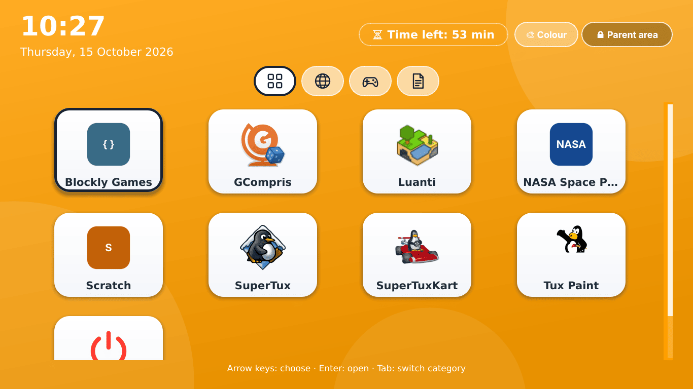
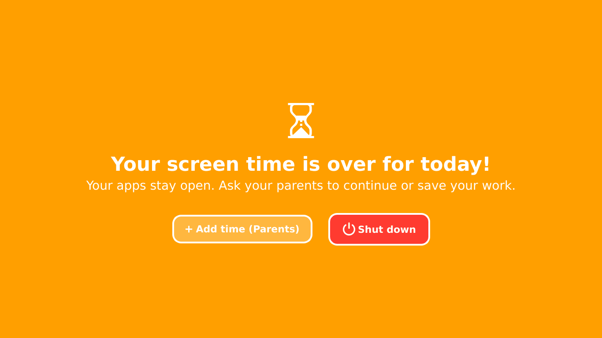
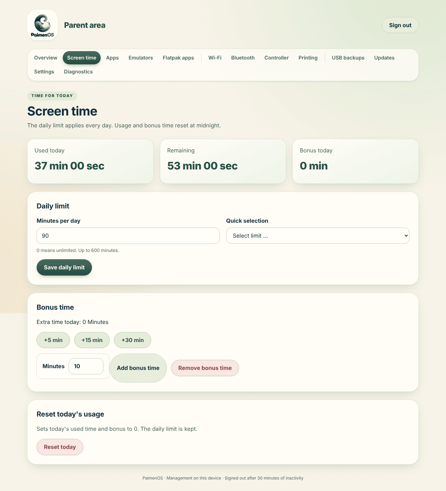
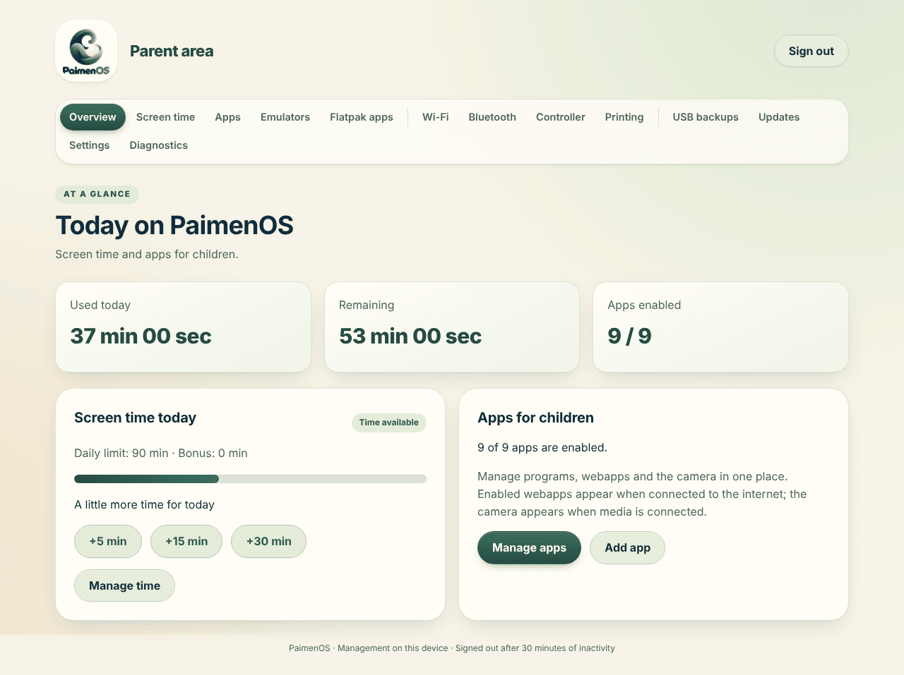
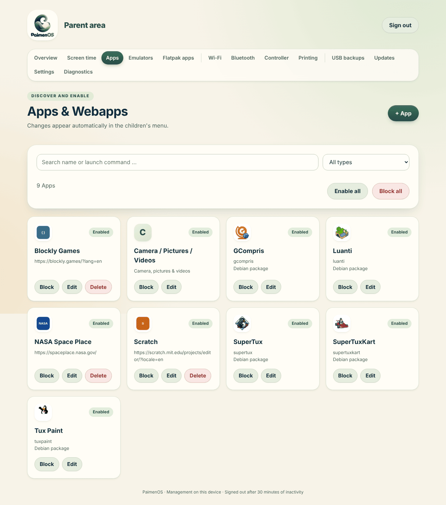
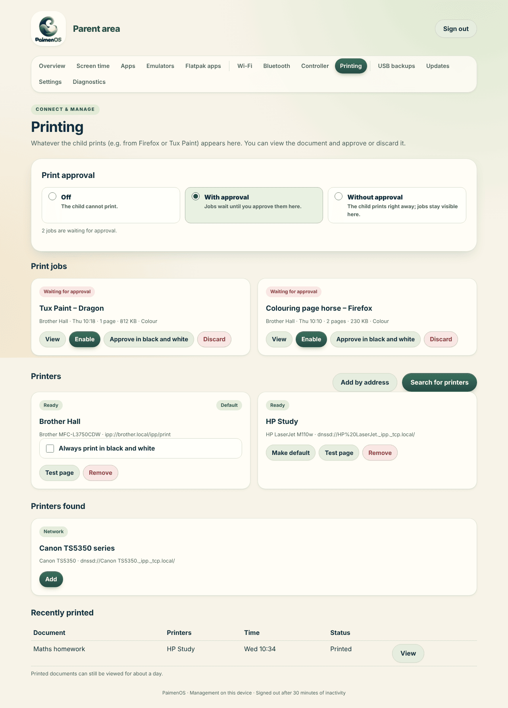

<p align="center">
  
</p>

<h1 align="center">PaimenOS</h1>

<p align="center">
  <b>A locked-down operating system for children, built on Debian</b><br>
  Tile menu for kids · screen time with lock screen · parent area in the browser · printing with approval · emulators · own installer ISO
</p>

<p align="center">
  <a href="README.de.md">Deutsch</a> ·
  <a href="#installation">Installation</a> ·
  <a href="#troubleshooting">Troubleshooting</a> ·
  <a href="docs/">Documentation</a>
</p>



PaimenOS turns a laptop into a children's computer that feels like a device of its own, not like a desktop with parental controls bolted on. After power-on the tile menu appears straight away; there is no desktop, no file manager and no system settings for the child to reach. Parents decide what is allowed, how long the child may play and what gets printed, in the parent area on the laptop or from their phone.

*Paimen* is Finnish for shepherd. Current version: see [`VERSION`](VERSION) and the [release notes](docs/releases/). Developed with the help of Claude AI, see [Built with AI](#built-with-ai-claude).

## Contents

- [Features](#features)
- [Installation](#installation)
- [Updates and rollback](#updates-and-rollback)
- [Troubleshooting](#troubleshooting)
- [Built with AI (Claude)](#built-with-ai-claude)
- [Development](#development)
- [Repository layout](#repository-layout)
- [Further documentation](#further-documentation)

---

## Features

### Kids' menu

The menu is the only interface the child sees. It starts automatically after boot (LightDM autologin for the user `kids`, Openbox without a desktop) and comes back to the front whenever an app is closed.

- **Large tiles** for programs, webapps, games, emulator games, the camera and shutting down.
- **Categories** as icon tabs (All, Webapps, Games, Create); empty categories are hidden.
- **Mouse, keyboard, touchpad or gamepad.** Arrow keys or the d-pad select, Enter or the confirm button opens, Tab or the shoulder buttons switch category. Win+M brings the menu back at any time.
- **Header** with clock, date, battery level, remaining screen time and the number of print jobs waiting.
- **Own colour:** the child picks the background colour with **Colour**.
- **Read aloud:** optionally the menu speaks the name of the selected tile (Piper, male or female voice, works offline).
- **Webapps only when online:** without a connection webapp tiles are hidden instead of opening error pages.
- **Volume and brightness** with F1–F3 and F5/F6 or the hardware keys, with an on-screen display.

### Screen time and lock screen

 

- **Daily limit** in minutes (0 = unlimited), reset every day at midnight.
- **Bonus time** at the push of a button (+5, +15, +30 minutes or any amount), on the laptop with the parent PIN or remotely.
- **Lock screen instead of a crash:** when time runs out, an opaque lock covers every screen. Open apps, games and emulators keep running underneath so nothing is lost. Parents can add time or shut the device down.
- **Hard to get around:** Win+M, Alt+F4, Escape, controller buttons and new app starts do not lift the lock; a second monitor is covered too.

### Parent area in the browser



There is exactly one parent area: a web interface on port 80. On the laptop the **Parent area** button in the menu opens it; from any other device on the same network use `http://<device-IP>/`.

- **Protected by the parent PIN** (4–12 digits, set during setup; 5 attempts per minute). Sessions expire after 30 minutes. On the laptop it runs in a browser profile that forgets everything, so the child cannot get back in after it is closed.
- **Pages:** Overview, Screen time, Apps, Emulators, Flatpak apps, Wi-Fi, Bluetooth, Controller, Printing, USB backups, Updates, Settings and Diagnostics.
- **English and German:** the interface follows the system language chosen during installation.

### Apps and webapps



- **Native apps** chosen during setup: Scratch, Tux Paint, LibreOffice, GIMP, Geany, Luanti, SuperTuxKart, SuperTux, GCompris, Tux Math, VLC, Terminal. Source is Flathub (recommended) or Debian.
- **More apps from Flathub:** search, install and remove them in the parent area; managed Flatpaks are updated automatically every week.
- **Webapps** open children's websites in Firefox with their own profile, back/forward and a button back to the menu, without an address bar. English systems start with PBS KIDS Games, LearnEnglish Kids, NASA Space Place, Blockly Games and Scratch; German systems with Die Maus, Der Elefant, KiKA, Kikaninchen, YouTube Kids, fragFINN and Blinde Kuh. Add your own webapps with an address and an image.
- **Enable and lock** apps one by one or all at once; changes show up in the menu immediately.
- **Hardware profiles** (`ultra-low` to `high`) tune demanding apps such as Luanti and SuperTuxKart to the laptop's performance.

### Emulators and games

- Install the consoles you want: NES, SNES, Game Boy / Color, Game Boy Advance, PlayStation 1, Mega Drive, Master System, Game Gear, Nintendo 64, PSP and GameCube / Wii (Dolphin).
- **Upload ROMs in the parent area;** every game becomes its own tile in the menu. BIOS files are uploaded and checked there too.
- **Progress is kept:** games are saved on exit and resume where they left off, even when screen time runs out mid-game.
- **Controllers** are mapped automatically; a wizard in the parent area sets up missing mappings. Parents pair Bluetooth controllers on the **Bluetooth** page.

ROMs and BIOS files are not included.

### Printing with parental approval



The child prints as usual from webapps or Tux Paint. Depending on the mode nothing is printed (**Off**, the default), every job waits for approval (**With approval**) or prints right away and stays visible (**Without approval**). Parents preview the document first, then approve it, optionally in black and white, or discard it. On the same page printers are discovered, added by address (IPP Everywhere / AirPrint without drivers), tested and removed. Details: [docs/printing.md](docs/printing.md).

### Camera, pictures and videos

When a camera, SD card or USB stick is plugged in, the **Camera / Pictures / Videos** tile appears. Pictures and video clips (MP4, MOV, MKV, WebM, AVI and more) open in the built-in viewer; pictures can be opened straight in Tux Paint to paint on. The medium is ejected safely.

### Safe network

- **Family DNS** system-wide (Cloudflare Family and AdGuard Family), plus DNS over HTTPS with AdGuard Family in Firefox.
- **Firefox policies:** uBlock Origin with cookie-banner lists; developer tools, private browsing and `about:config` are blocked.
- **Wi-Fi:** scan, connect and manage saved networks in the parent area; school or company networks and VPNs via the network editor on the laptop.
- **No system rights for the child:** root services never load code from the child's home directory; removable media and shutdown are allowed selectively through Polkit.

### Device, power and maintenance

- **Power saving:** idle Bluetooth controllers are disconnected after 5 minutes; after 30 minutes without input or sound the laptop suspends. TLP and ZRAM come preconfigured.
- **Own boot theme** (Plymouth) with the PaimenOS logo instead of scrolling text.
- **Updates from the parent area:** check for and install new releases from GitHub; missing Debian packages are installed along the way, and the update switches back by itself if a service fails to start. Debian security updates run automatically.
- **USB backups** of games, saves, BIOS files, app data and your own files, with checksums and restore.
- **Diagnostics page** with service status, logs and hardware information, downloadable as a text file.
- **Offline installation:** the ISO carries a signed package repository for the core system; the rest can be completed later with one click.

---

## Installation

PaimenOS is installed on a **laptop dedicated to the child**. It is mainly tested on a Lenovo ThinkPad T450; any x86-64 laptop that Debian supports should work.

There are two ways:

| | ISO (recommended) | `install.sh` on existing Debian |
|---|---|---|
| Starting point | empty laptop, USB stick | fresh Debian 12 (bookworm) or 13 (trixie) |
| Disk | **completely erased** | stays as you set it up |
| Internet | recommended, offline core possible | required |

### Option A: installer ISO

1. **Build the ISO:** on GitHub open **Actions → Build PaimenOS ISO → Run workflow** and choose the branch. The artifact **PaimenOS-ISO-amd64** contains the ISO and its SHA-256 (available for seven days).
   You can also build locally, in Debian 13 as root:
   ```bash
   apt-get install -y live-build debootstrap git ca-certificates xorriso squashfs-tools \
     grub-pc-bin grub-efi-amd64-bin mtools dosfstools
   bash iso/build.sh            # output in dist/iso/, built from git archive HEAD
   ```
2. **Write it to a USB stick**, e.g. `sudo dd if=PaimenOS-*.iso of=/dev/sdX bs=4M status=progress conv=fsync` or balenaEtcher.
3. **Boot from the stick** (BIOS or UEFI) and choose **PaimenOS installieren** (install PaimenOS). The installer asks for language, keyboard, time zone, Wi-Fi, target disk and an administrator account (not `kids`). The whole disk is used. Choosing English here makes the setup, menu and parent area English.
4. The installed system starts directly (via `kexec`) into **PaimenOS setup** on the first console:
   - **1** set up Wi-Fi/network (`nmtui`)
   - **2** start PaimenOS setup
   - **4** network diagnostics / IPv4 test
5. In setup choose the **parent PIN**, **hardware profile**, **emulators**, **apps** and **package source**. Then reboot: the kids' menu appears.

> **Leave the USB stick plugged in** until setup has finished. Without internet, setup installs the core system from the offline repository on the stick. Emulators, Flathub apps, speech output and website logos are completed later with the **Complete now** button on the parent area's overview page.

More: [docs/iso.md](docs/iso.md) (German).

### Option B: `install.sh` on fresh Debian

1. Install a minimal Debian 12 or 13 (no desktop) with internet access and an administrator with `sudo`. Choose English as the system language for an English PaimenOS.
2. Download and extract a release archive from [GitHub Releases](https://github.com/xJohnDoe993/PaimenOS/releases), or clone the repository. The **whole project** has to be on the device.
3. In the project directory:
   ```bash
   sudo bash install.sh
   ```
4. Enter the parent PIN twice, then choose hardware profile, emulators, apps and package source.
5. When setup reports *Installation completed successfully*, reboot yourself:
   ```bash
   sudo reboot
   ```

Setup runs in modules (`installer/10-system.sh` to `99-finish.sh`): packages, hardware, boot theme, the `kids` user, Firefox and DNS, apps, defaults, services, desktop and finish. An existing network connection stays up during installation; a Debian ifupdown Wi-Fi is handed over to NetworkManager on the first reboot.

**Unattended installation** (use `sudo env`, because `sudo` clears the environment otherwise):

```bash
sudo env PAIMENOS_PARENT_PIN=4711 PAIMENOS_APPS="2 6 9" PAIMENOS_APP_SOURCE=flathub \
  PAIMENOS_EMULATORS=empfohlen PAIMENOS_HARDWARE_PROFILE=low bash install.sh
```

| Variable | Meaning |
|---|---|
| `PAIMENOS_PARENT_PIN` | Parent PIN, 4–12 digits. There is no default PIN |
| `PAIMENOS_APPS` | Numbers from the app dialog, e.g. `"2 6 9"`; `13` = none |
| `PAIMENOS_APP_SOURCE` | `flathub` or `debian` |
| `PAIMENOS_EMULATORS` | `empfohlen` (recommended), `all`, `none` or IDs from `data/emulator-catalog.json`, e.g. `nes,snes,gba` |
| `PAIMENOS_HARDWARE_PROFILE` | `ultra-low`, `low`, `medium`, `high` |
| `PAIMENOS_ENABLE_TLP`, `PAIMENOS_ENABLE_ZRAM` | `1`/`0`, default `1` |
| `PAIMENOS_ENABLE_AUTO_UPDATES`, `PAIMENOS_ENABLE_APP_UPDATES` | Debian security updates and Flatpak updates, default `1` |
| `PAIMENOS_REBOOT` | `1` = reboot automatically at the end, default `0` |

All options: `bash install.sh --help` and [docs/installation.md](docs/installation.md) (German).

### After the first boot

1. Open the **parent area** (button in the menu or `http://<device-IP>/`) and sign in with the PIN. `hostname -I` on the device or your router shows the IP.
2. Set a daily limit under **Screen time** and check what is enabled under **Apps**.
3. Set up **Wi-Fi**, **Bluetooth** controllers and **printers** as needed.
4. The checklist in [docs/device-validation.md](docs/device-validation.md) (German) helps when testing a new device.

---

## Updates and rollback

**In the parent area:** open **Updates**, check for new versions, install. Close apps and games first and plug in the charger. Services and the kids' menu restart afterwards. Parent settings, app lists, pictures, ROMs and saves are kept.

**Manually**, from the extracted new release:

```bash
bash update.sh --check                         # check only
sudo bash update.sh                            # full update
bash update.sh --list                          # list components
sudo bash update.sh --component controller     # update single components
sudo bash update.sh --rollback                 # reactivate the previous code version
cat /usr/local/lib/paimenos/current/installed.json   # installed versions
```

Every version lives under `/usr/local/lib/paimenos/releases/`; the `current` link is switched atomically and `previous` points to the version before. If a service does not start after switching, the update switches back by itself. A rollback only affects code and PaimenOS services, not settings, saves or packages. Updates do not change system configuration (DNS, Firefox policies, Plymouth); the steps for that are in [docs/updating.md](docs/updating.md) and [docs/installation.md](docs/installation.md) (German).

---

## Troubleshooting

### Start here: the Diagnostics page

**Diagnostics** in the parent area shows service status, event and error logs, media, battery, memory, temperatures and Flatpak status, and offers everything as a downloadable text file for bug reports. Emulators have their own **emulator diagnostics** with the last RetroArch start log.

### Services

System services (running as root or `kids`):

| Service | Purpose |
|---|---|
| `paimenos-parent-web` | Parent area on port 80 |
| `paimenos-packages` | checks required Debian packages at boot |
| `paimenos-updates` | update check and installation |
| `paimenos-wifi`, `paimenos-bluetooth` | Wi-Fi and Bluetooth management |
| `paimenos-print` | print approval via CUPS |
| `paimenos-emulators` | emulator installation |
| `paimenos-power` | suspend after inactivity |
| `paimenos-wifi-migration` | takes over an ifupdown Wi-Fi on the first reboot |
| `paimenos-app-update.timer` | weekly Flatpak updates |

User services of the kids' session (`paimenos-session.target`): `paimenos-menu`, `paimenos-timer` (screen time), `paimenos-media` (USB/SD), `paimenos-osd`, `paimenos-idle`, `paimenos-cursor`.

```bash
# System services
systemctl status 'paimenos-*'
sudo journalctl -b -u paimenos-parent-web -u paimenos-updates -u paimenos-print

# User services of the kids' session
sudo journalctl -b --user-unit paimenos-menu.service --user-unit paimenos-timer.service
sudo runuser -u kids -- env XDG_RUNTIME_DIR=/run/user/$(id -u kids) \
  systemctl --user status paimenos-session.target paimenos-menu paimenos-timer

# Restart a single service
sudo systemctl restart paimenos-parent-web
sudo runuser -u kids -- env XDG_RUNTIME_DIR=/run/user/$(id -u kids) systemctl --user restart paimenos-menu
```

The journal is limited to 128 MB and 14 days.

### Log files

| File | Contents |
|---|---|
| `/home/kids/.local/state/paimenos/paimenos-events.log` | events from the menu and services |
| `/home/kids/.local/state/paimenos/paimenos-errors.log` | unexpected errors in the kids' menu |
| `/home/kids/.local/state/paimenos/paimenos-application.log` | output of launched apps |
| `/home/kids/.local/state/paimenos/paimenos-session.log` | session start when user services are unavailable |
| `/home/kids/.local/share/paimenos/emulators/retroarch-last.log` | last emulator start |
| `/var/log/paimenos-install.log` | ISO installer (in the live system) |
| `/var/lib/paimenos/wifi-migration/` | `completed.json` / `failed.json` of the Wi-Fi handover |
| `/etc/paimenos-laptop.installed` | completion marker: if it is missing, setup did not finish |

### Common problems

<details>
<summary><b>Setup was interrupted</b></summary>

The completion marker is written only at the very end. Simply resume; the PIN is kept:

```bash
sudo bash install.sh --resume                         # option B
sudo bash /opt/paimenos-source/install.sh --resume    # after an ISO installation
```

If setup reports *PaimenOS maintenance is already running*, another setup or update still holds `/run/paimenos-maintenance.lock`. Wait or reboot.
</details>

<details>
<summary><b>ISO setup finds no internet</b></summary>

Choose **4** in the setup menu, or on a second console (Ctrl+Alt+F2):

```bash
python3 /opt/paimenos-source/iso/prepare-apt.py --diagnose
```

It shows APT errors, routes, name resolution and TCP tests to `deb.debian.org`. If only IPv6 is broken, setup falls back to IPv4 automatically. Without internet you can continue with the offline packages from the stick.
</details>

<details>
<summary><b>The parent area does not open</b></summary>

The menu then reports that the service is not responding.

```bash
systemctl status paimenos-parent-web paimenos-packages
sudo journalctl -b -u paimenos-parent-web -u paimenos-packages
```

The web service starts only after `paimenos-packages`, which installs missing packages (needs internet). From a phone: it must be on the same network as the laptop, and the address starts with `http://`, not `https://`.
</details>

<details>
<summary><b>Forgotten parent PIN</b></summary>

The PIN is stored in `/home/kids/.config/paimenos/settings.json`. Reset it with administrator rights:

```bash
sudo python3 - <<'EOF'
import json, pathlib
p = pathlib.Path('/home/kids/.config/paimenos/settings.json')
d = json.loads(p.read_text()); d['pin'] = '4711'   # new PIN, 4–12 digits
p.write_text(json.dumps(d, indent=2, ensure_ascii=False))
EOF
```

Then choose your own PIN under **Settings** in the parent area.
</details>

<details>
<summary><b>No internet, or websites blocked</b></summary>

```bash
resolvectl status          # under "Global": family DNS servers and "DNS Domain: ~."
sudo journalctl -b -u paimenos-wifi-migration.service
```

Re-apply family DNS: `sudo python3 /usr/local/lib/paimenos/current/tools/configure-dns.py family /usr/local/lib/paimenos/current/config/resolved/paimenos-family-dns.conf`. Webapp tiles are hidden on purpose while there is no internet connection.
</details>

<details>
<summary><b>An update fails, or something does not start afterwards</b></summary>

APT or DNS errors abort the update before switching; the old version stays active. If a service fails to start after switching, the update switches back automatically. Manually:

```bash
sudo journalctl -b -u paimenos-updates
sudo bash update.sh --rollback
```

If APT reports a broken package system after a power loss: `sudo dpkg --configure -a`, then try again.
</details>

<details>
<summary><b>Printing does not work</b></summary>

First check the mode on the **Printing** page (the default is **Off**). Then:

```bash
systemctl status paimenos-print cups
lpstat -t
sudo journalctl -b -u paimenos-print -u cups
```

Firefox picks up a changed printing mode the next time a webapp starts.
</details>

<details>
<summary><b>An emulator game does not start</b></summary>

Open **Emulators → Open emulator diagnostics** in the parent area, or read `~kids/.local/share/paimenos/emulators/retroarch-last.log`. Common causes: a missing BIOS (PS1 needs `scph5500/5501/5502.bin` matching the game's region), an unsupported file format, or the emulator is not installed yet (`sudo journalctl -u paimenos-emulators`).
</details>

<details>
<summary><b>Videos do not play</b></summary>

Usually Qt Multimedia or GStreamer packages are missing; a full update installs them. Manually:

```bash
sudo apt-get install -y python3-pyqt5.qtmultimedia libqt5multimedia5-plugins \
  gstreamer1.0-plugins-base gstreamer1.0-plugins-good gstreamer1.0-libav
```
</details>

<details>
<summary><b>Reset the boot theme</b></summary>

```bash
plymouth-set-default-theme --list
sudo plymouth-set-default-theme -R pixels       # or any other installed theme
sudo python3 /usr/local/lib/paimenos/current/tools/install-paimenos-plymouth.py --activate   # back to the PaimenOS theme
```
</details>

Important paths on the device:

| Path | Contents |
|---|---|
| `/usr/local/lib/paimenos/current` | active code version (`previous` = the one before) |
| `/home/kids/.config/paimenos/` | `settings.json` (PIN, time, colour), `apps.json` |
| `/home/kids/.local/share/paimenos/` | icons, controller profiles, games, saves |
| `/var/lib/paimenos/` | system state: emulators, Flatpaks, printing, updates |
| `/opt/paimenos-source/` | setup source after an ISO installation |

---

## Built with AI (Claude)

PaimenOS started as a single shell script that set up a children's laptop. From roughly release 0.30.0 onwards it was developed with the help of the AI assistant [Claude](https://claude.ai) by Anthropic, and grew into the project it is today: a Python package, a modular installer, its own ISO, a parent web area, an update system and an automated test suite. Code, documentation and the screenshots in this README were largely written or produced with Claude; design decisions, testing on real devices and releases are done by the maintainer.

## Development

```bash
python3 tools/build-shell-translations.py   # after changing translated installer texts
python3 tools/build-manifest.py             # after adding or removing files
python3 -B tools/check.py                   # syntax, resources, manifest and all tests; offline, installs nothing
python3 tools/build-release.py              # ZIP and SHA-256 in dist/
```

GUI tests need PyQt5 and an X11 session, parent area tests need Flask. Without them the affected tests are skipped.

**Deploy to a test device** (also copies uncommitted changes):

```bash
make deploy                                           # SSH alias paimenos-t450
make deploy DEVICE=user@192.168.1.50 ARGS="--component desktop"
```

**Test VM:** `tools/vm.sh` creates a Debian 13 VM under QEMU/KVM, installs PaimenOS in it and deploys changes (`create`, `start`, `install`, `deploy`, `snapshot`, `reset`). The parent area is then at `http://localhost:8080`.

**Releases:** **Actions → PaimenOS Release** (tag like `v0.72.0`) creates a draft release with ZIP and SHA-256. `VERSION` and `manifest.json` must carry the same version. Details: [docs/updating.md](docs/updating.md#automatischer-release-build-auf-github).

**Translations:** German is the source language; English strings live in `assets/i18n/en.json`. See [docs/localization.md](docs/localization.md).

The screenshots in [`docs/screenshots/`](docs/screenshots/) were taken from the real menu (Xvfb, 1366×768) and the real parent area with sample data, in English (`en/`) and German (`de/`).

## Repository layout

| Directory | Contents |
|---|---|
| `src/paimenos/` | Python package: menu, screen time, lock screen, parent area, Wi-Fi, Bluetooth, controllers, emulators, printing, updates |
| `installer/` | modular setup (`10-system.sh` … `99-finish.sh`) and shared helpers |
| `iso/` | ISO build, live menu, ISO installer and offline repository |
| `config/` | Openbox, LightDM, Firefox, Polkit, NetworkManager, DNS, TLP, ZRAM, udev |
| `systemd/` | system and user services |
| `assets/` | logo, icons, Plymouth theme, parent area HTML, translations |
| `data/` | default apps and settings, emulator catalogue, package lists |
| `bin/`, `sbin/` | launch commands (volume, brightness, emulator, hardware profile, Wi-Fi handover) |
| `tools/` | deployment, release, checks and installation helpers |
| `tests/` | automated tests |
| `docs/` | detailed documentation (mostly German) |

## Further documentation

Most detailed guides are in German.

| Topic | File |
|---|---|
| Installation in detail, DNS, Wi-Fi, Piper | [docs/installation.md](docs/installation.md) |
| ISO and offline installation | [docs/iso.md](docs/iso.md) |
| Updates, releases, partial updates, rollback | [docs/updating.md](docs/updating.md) |
| Architecture and paths | [docs/architecture.md](docs/architecture.md) |
| Parent area on the device | [docs/parent-area.md](docs/parent-area.md) |
| Printing | [docs/printing.md](docs/printing.md) |
| Webapps | [docs/webapps.md](docs/webapps.md) |
| Flatpak apps | [docs/flatpak-apps.md](docs/flatpak-apps.md) |
| USB backups | [docs/usb-backups.md](docs/usb-backups.md) |
| Hardware profiles | [docs/hardware-profiles.md](docs/hardware-profiles.md) |
| Emulator performance | [docs/emulator-performance.md](docs/emulator-performance.md) |
| Screen time and saves | [docs/screen-time-preservation.md](docs/screen-time-preservation.md) |
| Languages | [docs/localization.md](docs/localization.md) |
| On-device checks | [docs/device-validation.md](docs/device-validation.md) |
